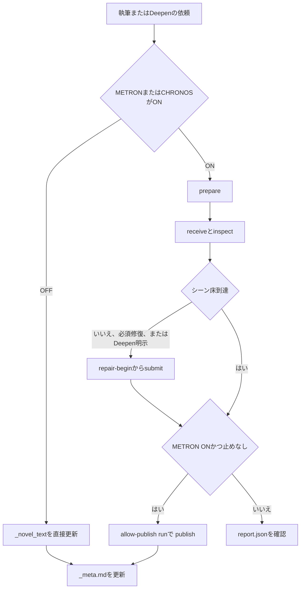

# Writing bridge の局所修復と本文反映

このガイドを読むと、計測済みの作業稿をファイル受け渡しで修復し、同じ本文版の検査を確認したうえで、本文正本 `_novel_text` へ場面単位で反映できます。CLIは外部APIを呼びません。

## このドキュメントを使う場面

1. **どんな場面で使うか** — 作品の `config.md` で METRON と CHRONOS が ON のとき、続きの執筆・場面の Deepen・当該場面の正本保存をチャットで依頼する。2つのフラグは連動し、両方 ON か両方 OFF にします。両方 OFF の作品では接続 run を作りません。
2. **チャットへの指示文** — これだけで動きます。
   - `第1章を執筆してください。`
   - `この場面をDeepenしてください。`
   - `当該場面を保存してください。`（METRON ON では省略できます）
3. **Monogatari Coach が行うこと** — フラグを読み、経路を一つ選びます。ON なら、第1章の初稿や単一章の依頼でも、契約と Beat を先に置いて `prepare` → 候補の `receive` / `inspect` に進みます。`_novel_text` へ直接書いてから測る流れにはしません。CHRONOS ON では inspect の前に observations を書きます。初稿は指示目標以上を1回で狙います（助言。未達でも床到達なら保存を止めません）。シーン床に届いていれば修復を始めず、`--allow-publish` の run で `publish --dry-run` のあと `publish` まで進みます。未作成または空の正本には selector を付けません。床未達のとき、または「この場面をDeepen」と明示したときだけ `repair-*` します。修復を始めたら、今の CLI ではジョブを完走してから保存します。止めたいときはその旨を書いてください。保存のあと `_meta.md` のストーリー反映は別スキルです。場面に CHRONOS イベントが無い場合は、反映のあとに「未登録」と報告し、次回タスクへ登録を追記します（章の次回タスクは消しません）。
4. **ユーザーが確認できるもの** — `_writing/<scene>/<run>/` の `report.json`、`jobs/` のプロンプト、`_metron/<scene>/` の計測、反映後の `_novel_text` と `_novel_text_backup`。

清書（rewrite.md）は従来どおり別手順です。明示した `metron_cli.py` / `chronos_cli.py` はフラグ OFF でも拒否しません。

## 使う場面（技術）

「この場面をDeepenしてください」と対象を指定すると、Monogatari Coach は依頼範囲を確認し、契約・Beat・人物状態を修復文脈へ渡します。現在の生成モデルに承認済みのMETRON校正がある場合に利用できます。校正のないモデルはV0計測までとし、別モデルの校正を借りません。

ユーザーは `_writing/<scene>/<run>/jobs/` のプロンプト、`repair_state.json` の試行履歴、`report.json` の計測・C1結果を確認できます。作業稿と計測結果は `_metron/<scene>/` に残ります。CHRONOS ON でも対象場面のイベントが無い場合、`report.json` は `CHRONOS_NO_SCENE_EVENTS` を非ブロッキング警告として残します。この警告は本文保存を止めませんが、`chronos_registered: success` とイベント検査済みを同一視しません。CLIは外部APIを呼びません。

## 操作手順

先に通常の `prepare → receive → inspect` を実行します。正本へ反映する run は `prepare --allow-publish` が必要です。両検査がONならCHRONOSの文脈も取り込みます。METRON OFFでは修復を開始できません。本文を既に正本へ保存して初期ハッシュが変わったrunは再利用せず、新runを準備します。

`prepare` が書く `context.md` には、シーンと Beat の検査下限と、床以上の指示目標が並びます。指示目標は助言であり、未達だけでは検査を `TooShort` にしません。この表示は新しい `prepare` から有効です。既存 run の古い `instruction_chars` は現行の倍率ではありません。

## 速度のための運用（2026-09-12）

この節を読むと、計測の効果は残したまま、第13〜15章で時間がかかった手渡しを避けて章執筆できます。床到達後の止め方と明示 Deepen は CLI で固定されています。

ユーザーが「第N章を執筆してください」と入力すると、Monogatari Coach は次を守ります。

1. METRON ON なら、最初から契約・Beat・マーカー付き初稿で進めます。CHRONOS だけ先に保存してから測り直す手順にはしません。
2. 初稿は `context.md` の指示目標以上を1回で狙います（床 4,000 字なら目標 5,600 字が既定。助言であり、未達だけでは止めません）。床ちょうどは狙いません。
3. 初回の検査でシーン床に届き、必須修復も無ければ、修復を始めません。Beat ごとの字数目安や末尾密度の指摘は残して、保存へ進みます。必須修復（打切り・Beat 欠落など）が残るときは床到達後でも修復を始めます。
4. 途中の job を捨てて止めるときは `repair-finish` を使います。`--reason floor_met` は床到達時、`author_stop` は必須が無ければ床未達でも止められます。生成が途中で切れたときや、これ以上直せる箇所が無いときも、`repair-next` のあとに `author_stop` で証跡を残せます。発行済みジョブの記録ファイルが消えているときは止めます。
5. 指定した Beat だけを Deepen するときは `--intent explicit_deepen --scope beats --beat-ids` です。指定していない Beat は直しません。生成が途中で切れて修復ジョブを出せないときは `escalated` になり、新しい `prepare` に切り替えます。
6. 全文の書き直しは、修復開始前なら同じ起草 run へ受け直し、開始後なら新しい `prepare` に切り替えます。
7. 保存用の新しい run で観察結果を流用する `--from-run` は、CHRONOS ON かつ起草 run に observations があるときに限ります。CHRONOS OFF では付けません。CHRONOS ON では、初回の `inspect` の前に observations を書きます。
8. 未作成または空の正本へ新章を保存するときは selector を付けません。既存の非空本文を差し替えるときだけ heading などを付けます。見出しだけの stub を先に正本へ置きません。

詳細は作業計画 `_workingspace/plans/20260912_metron-ops-speed.md` にあります。

以下はコマンドの書式例です。`MODEL_ID` は実際の生成元と一致する校正済みモデルIDへ置き換えます。`--authorization` は既存の修復依頼の出典・対象範囲を記録する欄で、文字列を指定するだけで外部課金や正本更新を許可するものではありません。

修復状態を開始し、次のジョブを取得します。

```powershell
# 指定場面の修復依頼を記録する。本文正本は更新しない。
python tools/writing_bridge_cli.py repair-begin novels/NNN_作品名 --scene-id ch01-001 --run-id run-0001 --model MODEL_ID --authorization "ユーザー依頼: 第1章の当該場面をDeepen"
# 床到達後に Deepen だけ続けるときは列挙で明示する。authorization の自由文では判定しません。
python tools/writing_bridge_cli.py repair-begin novels/NNN_作品名 --scene-id ch01-001 --run-id run-0001 --model MODEL_ID --authorization "ユーザー依頼: 第1章をDeepen" --intent explicit_deepen --scope scene
# 指定 Beat だけを Deepen する。指定外の Beat は直しません。
python tools/writing_bridge_cli.py repair-begin novels/NNN_作品名 --scene-id ch01-001 --run-id run-0001 --model MODEL_ID --authorization "ユーザー依頼: 到達場面だけDeepen" --intent explicit_deepen --scope beats --beat-ids reach_station
# ジョブのプロンプトをファイルへ出して終了する。生成は行わない。
python tools/writing_bridge_cli.py repair-next novels/NNN_作品名 --scene-id ch01-001 --run-id run-0001
# 未提出の job を破棄して修復を閉じる。
python tools/writing_bridge_cli.py repair-finish novels/NNN_作品名 --scene-id ch01-001 --run-id run-0001 --reason floor_met --authorization "ユーザー依頼: 床到達のため Deepen を止める"
```

`jobs/JOB-0001.json` と `jobs/JOB-0001.prompt.md` が作成されます。エージェントがそのプロンプトを読んで候補を書きます。Deepen・再生成は対象Beatの本文を返し、結合校正は全Beatのマーカーを残します。結合校正の残存率と短縮検査は、マーカーを外した全文ではなく、実際に採用するBeat結合本文に対して行います。生成打切り（`length` / `max_tokens`）は、候補本文のハッシュが一致する metrics / generation からのみ引き継ぎます。同じ文字数の別候補へは継承しません。打切りは欠落Beatがあっても自動修復せず、`regenerate` も出しません。`receive --finish-reason` でその版の来歴を明示できます。修復の現在候補は、受領済みの最新出力です。出力ファイルは残っているが receive が完了していないときは開始稿のまま再開できます。受領後に開始稿を戻すと版競合になります。

候補を読み直し、出来事・視点・結末・人物状態を維持していると確認した場合に結果を提出します。

```powershell
# confirmed は意味のレビュー済みという申告。数値検査とは別に記録する。
python tools/writing_bridge_cli.py repair-submit novels/NNN_作品名 --scene-id ch01-001 --run-id run-0001 --job-id JOB-0001 --model MODEL_ID --candidate path/to/candidate.md --review confirmed
```

未確認時は `--review unverified`、意味の変更があれば `--review rejected` を指定します。候補は履歴に残り、修復稿には適用しません。短縮・同文・残存率不足・高類似の反復・マーカー不正は共通の検証処理が棄却します。

結果が失われたジョブは、自動で生成し直さず、明示的に失敗を確定できます。

```powershell
# candidate の代わりに、結果が得られなかった理由を指定する。
python tools/writing_bridge_cli.py repair-submit novels/NNN_作品名 --scene-id ch01-001 --run-id run-0001 --job-id JOB-0001 --model MODEL_ID --error "生成結果を取得できなかった"
```

受領後は作業稿が再計測されます。本文版が変わったら旧observationsを `observations_history/` へ退避し、新版は未確認に戻します。新しい作業稿を読み直し、その版の引用・座標・ハッシュでobservationsを作ります。

新しい根拠を検査し、次のジョブまたは完了状態を確認します。

```powershell
# 修復後の本文に対応するC1根拠を指定する。
python tools/writing_bridge_cli.py inspect novels/NNN_作品名 --scene-id ch01-001 --run-id run-0001 --observations path/to/new-observations.json
# 残るジョブがあれば同じ手順を繰り返す。
python tools/writing_bridge_cli.py repair-next novels/NNN_作品名 --scene-id ch01-001 --run-id run-0001
python tools/writing_bridge_cli.py status novels/NNN_作品名 --scene-id ch01-001 --run-id run-0001
```

C1 の引用座標を手計算する代わりに、正規化本文から一意の quote だけを探せます。意味の判定はしません。inspect と同じく、受領候補と正本の版がずれているときは `STALE_EVIDENCE` で止まります。同じ引用が 2 箇所以上あるときは推測せず止まります。見つからないときは `UNKNOWN_REF` です。

```powershell
# 正規化本文の一意引用から start / end / ハッシュを出す。本文は書き換えない。
python tools/writing_bridge_cli.py locate-quote novels/NNN_作品名 --scene-id ch01-001 --run-id run-0001 --quote "旅行用の上着"
```

`repair: completed` は修復の試行が終了した意味です。適格な追加候補が無くシーン床に届かないとき、または生成打切りのように job を出せない必須が残るときは `repair: escalated` になります。その稿は同じ run へ受け直さず、新しい `prepare` に切り替えます。必須修復も追加候補も無いときは、初回の `repair-next` から `pending` は空で、結合校正の job も出しません。どちらも METRON・C1 の成功や本文保存を意味しません。このあと新しい稿でやり直すときは、同じ run へ `receive` せず、新しい `prepare` の run を切ります。旧 run の observations や metrics は本文ハッシュが一致するときだけ `--from-run` で流用できます。`text_save` は `skipped` のままです。残る指摘は `report.json`、棄却・生成失敗・意味レビューは `repair_history` と `repair_state.json` で確認できます。修復の途中で C1 根拠がまだ無いときは、`status` に未記録として残りますがコマンドは失敗しません。完了後に根拠が無いときは従来どおり止まります。`status` と `report.md` は required（`BeatMissing` / 打切り）と advisory（`TooShort` / `BeatThin` / `EndingRush`）を分けます。「床到達・必須なし → 保存へ」は、床到達・必須なしに加え、検査の blocking がなく、C1 が成功しているか対象外（`skipped`）で、修復が進行中でないときだけ出ます。C1 未確認や Deepen の修復中には出しません。そのとき `metron_auto_repair: none` です。`metron: findings` だけでは修復を始めません。同じ受領候補を再度 `inspect` しても、計測ファイルの版は増えません。

## 本文正本への反映

`prepare` で `--allow-publish` を付けた run だけが正本へ書けます。権限の無い起草 run は `PERMISSION_DENIED` です。後から同じ run へ権限は付きません。METRON ON の作品では、執筆や Deepen の依頼だけで保存用 run まで進みます。CLI の `--allow-publish` は技術上の権限分離です。保存用の新しい run で候補の `receive` / `inspect` をやり直します。起草 run の本文 hash が一致する observations は `--from-run run-NNNN` で流用できます。CHRONOS OFF、または指定元に `observations.json` が無いときは `--from-run` を付けません。付けると `UNKNOWN_REF` で止まります。run ID 以外の値や作品フォルダの外を指す値は拒否します。不一致は `STALE_EVIDENCE` です。CHRONOS が ON のときは C1 が成功するまで正本を書きません。`--authorization` は出典を記録する欄で、課金やイベント上書きの許可にはなりません。

反映内容を dry-run で確認してから実行します。`--dry-run` は保存予定の**対象ファイル全体**（場面・前後・他シーンを含む合成本文）へ句読点ゲートをかけます。fail なら終了コード 1 で止まり、正本も退避も `publish_state` も書きません。表示には `scope=full_text` と `intended_text_sha256` / `intended_raw_sha256` が付きます。本番の `publish` は書いてから結合後の全文で句読点を記録し、fail でも本文は戻しません。途中で止まったあと再開できるのは、発行側が書いた記録（journal の `canonical text written`）があり、正本が保存予定の本文のままのときです。同じバイトのファイルが外から置いただけでは完了しません。次の `run-XXXX` は、この節の本番 `prepare --allow-publish` が返した id です。

未作成または空のファイルへ新章を書くときは、selector を付けません。未作成の本文に heading を付けると、`publish --dry-run` が `UNKNOWN_REF` になります。

```powershell
# レシピ1: 未作成または空の正本。selector なし。
python tools/writing_bridge_cli.py prepare novels/NNN_作品名 --scene-id ch01-001 --text-path _novel_text/novel_text01.md --request-kind new --allow-publish --dry-run --repo-root .
python tools/writing_bridge_cli.py prepare novels/NNN_作品名 --scene-id ch01-001 --text-path _novel_text/novel_text01.md --request-kind new --allow-publish --repo-root .
python tools/writing_bridge_cli.py receive novels/NNN_作品名 --scene-id ch01-001 --run-id run-XXXX --candidate path/to/marked.md
# CHRONOS ON かつ起草 run に observations があり本文 hash が一致するとき
python tools/writing_bridge_cli.py inspect novels/NNN_作品名 --scene-id ch01-001 --run-id run-XXXX --from-run run-0001
# CHRONOS OFF、または observations 欠落。--from-run は付けない（付けると UNKNOWN_REF）
python tools/writing_bridge_cli.py inspect novels/NNN_作品名 --scene-id ch01-001 --run-id run-XXXX --observations path/to/observations.json
python tools/writing_bridge_cli.py publish novels/NNN_作品名 --scene-id ch01-001 --run-id run-XXXX --authorization "ユーザー依頼: 第1章の当該場面を保存" --dry-run --repo-root .
python tools/writing_bridge_cli.py publish novels/NNN_作品名 --scene-id ch01-001 --run-id run-XXXX --authorization "ユーザー依頼: 第1章の当該場面を保存" --repo-root .
```

既存の非空本文を差し替えるときだけ heading などを付けます。無いと `MISSING_FIELD` になり、ファイル全体は置換しません。以降の `receive` → `inspect` → `publish` はレシピ1と同じです。

```powershell
# レシピ2: 既存の非空本文。heading で当該章だけを置換する。
python tools/writing_bridge_cli.py prepare novels/NNN_作品名 --scene-id ch01-001 --text-path _novel_text/novel_text01.md --request-kind refine --selector-kind heading --selector-value "章タイトル" --allow-publish --dry-run --repo-root .
python tools/writing_bridge_cli.py prepare novels/NNN_作品名 --scene-id ch01-001 --text-path _novel_text/novel_text01.md --request-kind refine --selector-kind heading --selector-value "章タイトル" --allow-publish --repo-root .
python tools/writing_bridge_cli.py receive novels/NNN_作品名 --scene-id ch01-001 --run-id run-XXXX --candidate path/to/marked.md
# CHRONOS ON かつ起草 run に observations があり本文 hash が一致するとき
python tools/writing_bridge_cli.py inspect novels/NNN_作品名 --scene-id ch01-001 --run-id run-XXXX --from-run run-0001
# CHRONOS OFF、または observations 欠落。--from-run は付けない（付けると UNKNOWN_REF）
python tools/writing_bridge_cli.py inspect novels/NNN_作品名 --scene-id ch01-001 --run-id run-XXXX --observations path/to/observations.json
python tools/writing_bridge_cli.py publish novels/NNN_作品名 --scene-id ch01-001 --run-id run-XXXX --authorization "ユーザー依頼: 第1章の当該場面を保存" --dry-run --repo-root .
python tools/writing_bridge_cli.py publish novels/NNN_作品名 --scene-id ch01-001 --run-id run-XXXX --authorization "ユーザー依頼: 第1章の当該場面を保存" --repo-root .
```

実行後、Monogatari Coach は Beat / fact マーカーを除いた本文を `_novel_text` へ書きます。マーカー行のあいだに残った連続空行は、段落1つ分（空行1つ）まで畳みます。対象外の場面は残します。既存ファイルは `<元ファイル名>_vNNN.md` で退避します。`FINAL.md` は作りません。採用したマーカー稿は `_metron/<scene>/adopted.<run_id>.md` に残ります。見出しだけの stub を先に正本へ置くと `STALE_EVIDENCE` になりえます。

保存直後に同じ run で再計測します。`report.json` の `text_save` は `success`、`target_text_sha256` は保存本文です。METRON と C1 は採用した場面稿で測り、保存ファイルとハッシュが違うときは findings に残します。文字数と句読点ゲートも findings に記録します。句読点の失敗で本文は戻しません。`_meta.md` のストーリー反映と rewrite 清書は既存スキルの手順です。同じターンで `_novel_text` の手編集と `publish` は重ねません。



途中で失敗したときは候補と旧稿を残します。同じ `--authorization` で再開すると、本文が書けていれば検査から続け、二重退避しません。`publish_state.json` を書いたあとで正本が外部作成・削除・改変された場合は上書きせず `STALE_EVIDENCE` です。反映後に正本が変わっても同様です。修復が active のままでは publish できません。publish を始めた run へ別候補を `receive` することはできず、新しい run が必要です。`inspect --marked` は受領済み候補と同じ内容のパスだけを測ります。別内容を指定すると `STALE_EVIDENCE` です。

## 規定量調整（既にある本文を目標字数に合わせる）

METRON / CHRONOS が ON の作品で、既にある本文を目標字数へ伸縮するときの経路です。チャットでは次の一言で動きます。

```text
第3章を4000字に合わせてください。
```

Monogatari Coach は次の順に進めます。

1. `prepare --request-kind refine` の run で今の本文を `receive` → `inspect` する。
2. 当該場面に CHRONOS イベントがあれば、`canon-precheck` のイベント一覧と本文を Monogatari Coach が照合し、`--by agent` で記録する。ユーザーには尋ねない。食い違いの疑いがあるときだけ、始める前に相談する。イベントが無い場面では照合を省き、調整前の本文をそのまま基準にする。
3. `repair-begin --intent length --finish-target N` で始める。ユーザーの字数 N は、清書後の仕上がり目標として扱う。清書で削る分の余地（既定 +8%）を足した字数を増量の目標にし、許容帯（既定は目標の ±3%）を決める。許容帯の上限が場面の下限（床）より小さい指定は `LENGTH_CONFIG` で止まる。すでに許容帯に入っていれば `REPAIR_NOT_NEEDED` で止まる。増量の目標（余地込み）に対して本文が10%以上足りないときは、Deepen を始めず `DESIGN_DENSITY` で止まる（`repair_state.json` は作らない）。足す子エピソードを提案し、承認後に設計書と `_metron/<scene_id>/episodes.yaml`（`span_pending: true`）へ足してから加筆する。欠落 Beat があるときは止めずに先に埋め、埋めたあとの字数でもう一度不足率を見る。まだ10%以上足りなければ、Deepen へ進まず `DESIGN_DENSITY` で `escalated` になる。
4. `repair-next` が出す1件ずつのジョブに候補を作る。足りないときは増量（`deepen`）、超えているときは引き締め（`tighten`）だけを出し、増量と減量を往復しない。増量で上限を超えたときに限り、引き締めで戻す。
5. 増量と欠落 Beat の埋めは、機械検査（元文残存率・同義反復・短縮の棄却など）を通れば採用する。ユーザーに JOB ごとの「採用／否認」を尋ねない。差分は `canon_review.json` に証跡として残り、`length-review` でいつでも見られる。引き締めと収束は、消えた文をユーザーに見せ、出来事の欠落が無いと確認できたものだけを `--canon-authorization` 付きで採用する。欠落 Beat があっても開始でき、調整の最初に埋める。
6. 許容帯に入れば `repair: completed` になる。出力された作業稿（Beat マーカー付き）を続けて清書し（`rewrite.md`。床を割らないところで止める。仕上がり目標との数%（5%以内）の差は合わせ直さない）、`repair-summary --refined <清書稿>` で（清書稿は Beat の順序・Beat の間・章見出しなど Beat の外を作業稿のまま保つこと。変わっていれば `RANGE_MISMATCH` で受け付けない。Beat 指定の調整では、対象 Beat の仕上がりと床を、場面全体の床とは別に確かめる）、調整前 → 増量後 → 清書後の字数、清書で消えた文、場面内で3回以上に増えた語句の推移を含めて報告する。主要な変化（字数の前後、採用した JOB、新しい文と消えた文、順序が変わった文、補助の印、イベント照合の根拠、場面契約の終了状態と次章の書き出し）を一度だけ見せ、「この内容で保存してよいか」を尋ねる。ユーザーへの確認はこの1回だけで、返答は `repair-summary --accept --authorization` で記録する。そのあと保存用の新しい run で `publish` する。試行回数の上限（既定3回。却下した候補も数える）に達したときや、届かないときは `repair: escalated` で止まり、不足・超過の字数を `LENGTH_MAX_PASSES` / `LENGTH_ESCALATE_ADD`（出来事を足す加筆の提案）/ `LENGTH_ESCALATE_REVISE`（畳む・削る改稿の提案）として報告する。加筆・改稿は承認を得てから別の作業として行う。`repair-finish` で途中で止めた場合も、許容帯に入っていなければ `escalated` になる。

字数は Beat 本文の合計で数えます（Beat の外にある章見出しなどは含みません）。ユーザーが確認できるのは、run の `repair_state.json`（状態と報告）、`canon_review.json`（照合と候補ごとの確認の記録）、`jobs/` のジョブです。

```powershell
# イベントがある場面: 照合の材料を表示する（何も書かない）
uv run python tools/writing_bridge_cli.py canon-precheck novels/NNN_作品名 --scene-id ch03-001 --run-id run-0001
# ユーザーの返答を記録する（食い違いがあれば --result conflict）
uv run python tools/writing_bridge_cli.py canon-precheck novels/NNN_作品名 --scene-id ch03-001 --run-id run-0001 --result no_conflict --authorization "著者: 本文とイベントに矛盾なし"
# 規定量調整を始める。4000 は清書後の仕上がり目標で、増量は余地 +8% の 4320 を目標にする
# （--finish-margin / --tolerance 0.97,1.03 / --length-scope beat --length-beat-id ID / --max-passes 3 は任意。余地なしは --target-chars）
uv run python tools/writing_bridge_cli.py repair-begin novels/NNN_作品名 --scene-id ch03-001 --run-id run-0001 --model MODEL_ID --authorization "ユーザー依頼: 第3章を4000字に" --intent length --finish-target 4000 --repo-root .
uv run python tools/writing_bridge_cli.py repair-next novels/NNN_作品名 --scene-id ch03-001 --run-id run-0001 --repo-root .
# 候補の差分を見る（何も書かない。引き締め・収束の確認や、後からの指摘に使う）
uv run python tools/writing_bridge_cli.py length-review novels/NNN_作品名 --scene-id ch03-001 --run-id run-0001 --job-id JOB-0001 --candidate path/to/candidate.md --repo-root .
# 増量の候補を採用する（機械検査で採否が決まる）
uv run python tools/writing_bridge_cli.py repair-submit novels/NNN_作品名 --scene-id ch03-001 --run-id run-0001 --job-id JOB-0001 --model MODEL_ID --candidate path/to/candidate.md --review confirmed --repo-root .
# 引き締め・収束の候補は、ユーザーの確認を得てから出典を付けて採用する
uv run python tools/writing_bridge_cli.py repair-submit novels/NNN_作品名 --scene-id ch03-001 --run-id run-0001 --job-id JOB-0004 --model MODEL_ID --candidate path/to/tighten.md --review confirmed --canon-authorization "著者: 出来事の欠落なし" --repo-root .
# 続けて清書した稿（Beat マーカー付き）を渡し、保存前に主要な変化を一度だけ見せる → 返答を記録する
uv run python tools/writing_bridge_cli.py repair-summary novels/NNN_作品名 --scene-id ch03-001 --run-id run-0001 --refined novels/NNN_作品名/_metron/ch03-001/refined.run-0001.md --repo-root .
uv run python tools/writing_bridge_cli.py repair-summary novels/NNN_作品名 --scene-id ch03-001 --run-id run-0001 --refined novels/NNN_作品名/_metron/ch03-001/refined.run-0001.md --accept --authorization "著者: この内容で保存してよい" --repo-root .
# 章末を契約に合わせて書き直す（規定量調整とは別。Beat の床で長さを判定し、ユーザーの確認を要する）
uv run python tools/writing_bridge_cli.py repair-begin novels/NNN_作品名 --scene-id ch03-001 --run-id run-0002 --model MODEL_ID --authorization "ユーザー依頼: 章末を設計どおりに" --intent contract_fix --scope beats --beat-ids rest_hint --instruction "湯船から上がらず、休憩室を思い出すところで終える" --repo-root .
```

目標字数は beats.yaml の `length_target`（`target_chars` / `tolerance` / `scope` / `beat_id` / `max_passes`）にも書けます。CLI の指定と食い違うときは `JOB_CONFLICT` です。章単位の指定は受け付けないので、場面ごとに調整します。技法の基準は `_how_to.example/length_ops.md` です。

### 不足率の記録（`shortage_log.jsonl`）

`repair-begin` は規定量調整（`--intent length`）と自動修復（`auto` / `explicit_deepen`）のどちらでも、開始時の不足率を `_metron/<scene_id>/shortage_log.jsonl` に1行ずつ追記します（`at`、`run_id`、`intent`、`scope`、`target`、`chars`、`shortage`、`over_limit`、`stopped`）。`target` は規定量調整では余地込みの増量の目標、自動修復では場面の床です。自動修復は10%以上でも止めず、`DESIGN_DENSITY` を `repair_state.json` の notes に残して Deepen を続けます。止めるように切り替えるかは、この記録の頻度を見てから決めます。

### 収束・CANON 検査・改稿工程

収束対象があり、`max_passes` が2以上なら、引き締めに使う回数を全体上限の1回手前までに抑え、収束用に1回を残します。既定3回なら引き締めを最大2回、そのあと収束を試します。上限1回では引き締めだけを試します。増量後の上限超過には、この予約を適用しません。

- **収束**: 減量で引き締めが届かないとき、`_metron/<scene_id>/episodes.yaml` に登録した子エピソードを要約へ畳むジョブ（`condense`）が出ます。候補ファイルには、畳んだ文だけを書きます。`length-review` は、畳んだあとの Beat 全体で差分を見せます。登録が無い場面では収束しません。
- **CANON 検査**: 候補ごとに、別のモデル呼び出しで事実の照合を行えます。不合格の候補は、ユーザーの確認が無い限り採用されません。合格を確認の代わりにするのは、ユーザーが明示して `--check-replaces-author` で始めたときだけです。
- **改稿工程**: 減量が届かず `LENGTH_ESCALATE_REVISE` で止まったときは、削りたい部分ごとに `strip-check` で参照を確かめます。持ち帰り・他のイベントからの参照・後の本文に現れる語があれば終了コード 1 で、削らずに収束へ戻します。参照が無く、ユーザーが承認したときだけ `strip-record` で `_metron/<scene_id>/canon_deletions.yaml` に記録し、本文は refine run の `publish` で削ります。CHRONOS イベントは CHRONOS の承認手順で直します。

```powershell
# CANON 検査の指示を jobs/JOB-0001.canon_check.prompt.md に書く
uv run python tools/writing_bridge_cli.py canon-check novels/NNN_作品名 --scene-id ch03-001 --run-id run-0001 --job-id JOB-0001 --candidate path/to/candidate.md --repo-root .
# 別の呼び出しで得た JSON を判定して記録する（完了印と入力ハッシュを含む。不合格なら終了コード 1）
uv run python tools/writing_bridge_cli.py canon-check novels/NNN_作品名 --scene-id ch03-001 --run-id run-0001 --job-id JOB-0001 --candidate path/to/candidate.md --result path/to/check.json --checker-model CHECKER_ID --repo-root .
# 改稿工程: 削る前の参照チェック（参照があれば終了コード 1。何も書かない）
uv run python tools/writing_bridge_cli.py strip-check novels/NNN_作品名 --scene-id ch03-001 --quote "削りたい一文。"
# ユーザーが承認したあとに削除を記録する
uv run python tools/writing_bridge_cli.py strip-record novels/NNN_作品名 --scene-id ch03-001 --quote "削りたい一文。" --reason "山場の前を軽くする" --authorization "ユーザー承認: 改稿"
```

検査結果は、指示に記載された `input_sha256` をそのまま返し、`completed: true` と事実一覧・指摘一覧をすべて含める必要があります。候補検査では `facts_before` / `facts_after` にそれぞれ最低一文の事実を書き、`findings` / `condense` も省略しません。開始前照合では `facts` に最低一文を記録し、`conflicts` も省略しません。空のJSON・未完了・項目不足は `SCHEMA_UNSUPPORTED` です。

検査依頼は `jobs/JOB-xxxx.canon_check.request.json`、開始前照合は `canon_precheck.request.json` に保存されます。依頼前の結果読込は `UNKNOWN_REF`、依頼後に本文・候補・イベントなどが変わった結果の読込は `STALE_EVIDENCE` です。変更した場合は指示を再出力し、検査をやり直してください。別runの結果も流用できません。従来形式の検査結果も、この形式で検査し直す必要があります。

開始前の照合材料には、イベントの題名・人物だけでなく、因果参照（`causes` / `effects`）、時刻・場所・人物状態（`effects_on`）を含めます。改稿の引用指定でも、重なる登録済み子エピソードの持ち帰りを確認します。保護する契約の範囲を一意に特定できない場合は、契約の引用を修正してから再確認してください。

## OFF で下書きし、あとで ON にして洗練する

このガイドの手順は、METRON と CHRONOS が ON の作品で使います。新規作品は標準で OFF なので、まず OFF のまま下書きし、書き終えた章から ON にして洗練できます。従量課金の API を使うクライアント（Cursor で Gemini を使う場合など）で、使う量を抑えるための進め方です。

### どこで使う量が増えるか

writing_bridge・METRON・CHRONOS のツールは、どれも API を呼びません。量が増えるのは、ON のときに Monogatari Coach が書くものです。

| 工程 | ON のときに増えるもの |
|------|------------------------|
| 起草前 | 場面の契約（`contract.yaml`）と Beat の計画（`beats.yaml`） |
| 起草 | Beat マーカー付きの候補本文 |
| 検査 | CHRONOS の観察記録（引用の位置） |
| 修復 | Deepen などの書き直し候補 |
| CHRONOS | 章ごとの出来事（イベント）の登録 |

OFF のあいだは、本文を書く分だけになります。

### ON にするときの流れ

1. 作品の `_meta.md` の「検査レイヤの予定」に、ON にする時期と、どの章から測るかを書きます。
2. `config.md` の基本情報表で、`METRON` と `CHRONOS` を両方 `ON` にします。
3. 下書きの章を当面測らないときは、同じ表に `| METRON_FROM | 5 |` のように書きます。第5章より前は「計測対象外（下書き期）」になり、次の章へ進む前の後追い計測を求められません。
4. 次のコマンドで、保存先の準備と、測っていない章の一覧を確かめます。

```powershell
# CHRONOS の保存先を用意する（既にあれば何もしない）
uv run python tools/chronos_cli.py init novels/NNN_作品名
# 未計測・計測が古い・計測対象外の章を一覧する
uv run python tools/novel_project_check.py novels/NNN_作品名 --check-inspection-layers
```

5. チャットで「第3章を計測して洗練して」のように頼むと、Monogatari Coach は、本文の出来事を変えずに契約と Beat を起こし、上の「レシピ2」（既存の非空本文を heading で置き換える）の流れで計測・修復・反映します。反映のあとはストーリー反映も行います。
6. CHRONOS の出来事は、洗練する章から順に登録します。全章を一度に登録しません。

### 計測が古い章

計測のあとに本文を書き換えた章は、`--check-inspection-layers` で「計測が古い」と表示されます。OFF に戻していたあいだの直接の書き換えや、rewrite.md の清書が当てはまります。Monogatari Coach は、run が測った本文のハッシュと今の本文を比べて判定します（改行コードの違いと Beat マーカーは無視します）。計測が古い章は、もう一度後追い計測をかけると新しくなります。

清書そのものは、今までどおり計測を起動しません。ON の作品で清書した章は「計測が古い」になるので、洗練の段階でその章を計測し直してください。

### 後追い計測の作業稿で気をつけること

既稿に Beat マーカーを付けた作業稿を作るときと、修復の候補を書くときは、次の3点を守ります。パイロット作品（119）で実際につまずいた点です。

- 場面の区切り（`---`）は、Beat と Beat のあいだに置かず、次の Beat の先頭に入れます。Beat の外に本文が残ると、修復を始めるときに `RANGE_MISMATCH` で止まります。
- Deepen の候補では、元の文を消さず、足す文は文や段落の切れ目に置きます。一つの文の途中に文を割り込ませると、元の文が残っていないと判定され、元文残存率の不足で却下されます。台詞の行の直後に段落を挟むのは問題ありません（METRON は改行も文の切れ目として数えます）。
- 段落数や会話の往復が上限に達している Beat（修復指示の「残余裕 0」）では、新しい段落を作らず、既存の段落の末尾に文を足します。

### OFF に戻すとき

途中の修復（`repair-*`）や作業中の run が残っていると、次に ON にしたときに止まります。OFF に戻す前に、`repair-finish` などで閉じてください。閉じられないときは、Monogatari Coach は OFF にせずに理由を報告します。

## 中断と再開

- `repair-next` の再取得は同じpendingジョブを返します。Deepenは同一Beat最大2回、再生成は最大1回、結合校正はrun全体で最大1回です。空出力・失敗も1回です。
- 同一jobの同じ結果の再提出は試行を増やしません。候補・失敗理由・意味レビューを変更して同じjobへ提出すると `JOB_CONFLICT` になります。
- 本文・契約・人物初期値・links・校正などが途中で変わると `STALE_EVIDENCE` になります。新runで準備し直します。発行済みジョブ記録の欠落やプロンプトの書換えも拒否します。
- 状態は原子的に保存し、scene単位のOSロックで同時更新を拒否します。プロセスが終了するとロックは解放されます。確定後に成果物出力が中断した場合は `repair-next` で復旧できます。

## 実装境界

`metron.repair_steps` の `begin_repair / next_job / submit_result` はシリアライズ可能な状態を扱います。確定履歴を純粋な修復処理へ再投入し、次の未確定ジョブで即座に停止します。過去の生成を再実行しません。`repair_scene` も同じAPIを同期駆動します。

ジョブのprompt_hashは共通文脈・場面契約・修復時の全Beat本文を含む実際のプロンプト全体のSHA-256です。試行予約・結果確定とファイル出力は段階を分けて保存します。本文の意味の判断はエージェントに依存し、C1は記録した引用と状態値を検証します。自動抽出と外部providerは本工程に含めません。
