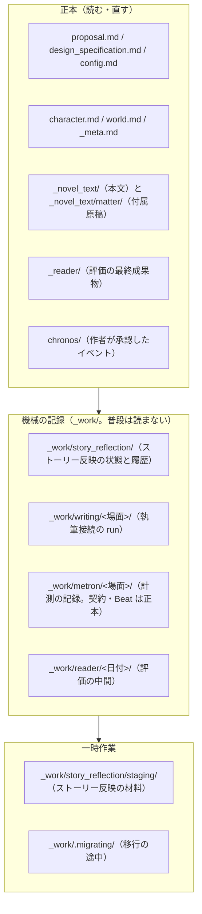

# 作品フォルダの構成

このガイドを読むと、作品フォルダ `novels/NNN_作品名/` の中で、どこが自分で読んで直すファイルで、どこが Monogatari Coach の機械が書く記録なのかが分かります。以前の構成の作品を新しい構成へ移す方法も分かります。

---

## このドキュメントを使う場面

| 場面 | 見るところ |
|------|------------|
| 作品フォルダを開いて、どれを読めばよいか知りたい | 下の「3つの層」 |
| `_work/` というフォルダが何か知りたい | 「機械の記録（`_work/`）」 |
| 以前の作品に `_writing/` や `_metron/` があり、整理したい | 「以前の構成から移す」 |

### チャットへの指示文

これだけ入力すれば動きます。

```text
novels/NNN_作品名 の作品フォルダを新しい構成へ移してください。
```

と入力すると、Monogatari Coach は次のように進めます。

1. 何をどこへ移すかを `--dry-run` で表示し、移してよいかを確かめます。`_meta.md` が以前の形なら、その並べ替えの要約も見せます。
2. 承認されたら移します。修復や保存（publish）が途中の作品は移さず、理由を報告します。
3. 移したあとに、古い構成の印が残っていないかを確かめます。

以前の構成の作品で「続きを書いて」「清書して」と頼んだときも、Monogatari Coach は作業の前に一度だけ「先に新しい構成へ移しますか」と聞きます。移さないと答えた作品では、同じことを聞きません。

### ユーザーが確認できるもの

- 作品フォルダの直下に、読む・直すファイルと `_work/` が並びます。
- `novel_project_check.py --check-layout` の結果に、古い構成の印が出なくなります。

---

## 3つの層

作品フォルダの中身は、次の3つの層に分かれます。



```
novels/NNN_作品名/
├─ proposal.md  design_specification.md  config.md  character.md  world.md  _meta.md
├─ _novel_text/                 # 本文（novel_textNN.md）
│  └─ matter/                   # 付属原稿（人物紹介・あとがき）。章として数えない
├─ _novel_text_backup/          # 本文と _meta.md の旧版
├─ _reader/                     # 評価・監査・照合の最終成果物
├─ chronos/                     # CHRONOS のイベント（作者が承認したもの）
├─ tag/  manga/  illustrations/ # 画像と漫画
├─ book.yaml  rights.yaml       # 出版パッケージ（必要な作品だけ）
└─ _work/                       # 機械の記録（普段は読まない）
   ├─ story_reflection/         # op.json・op.jsonl（ストーリー反映）と staging/（材料）
   ├─ writing/<場面>/           # 執筆接続の run-NNNN/
   ├─ metron/<場面>/            # contract.yaml・beats.yaml（正本）と計測の記録
   └─ reader/<日付>/            # 長文評価の中間ファイル
```

### 機械の記録（`_work/`）

`_work/` の中は、Monogatari Coach のツールが書いて読む記録です。普段は開く必要がありません。どのファイルがどこにあるかは、ツールが場面などの単位ごとに決めます。

例外は METRON の契約と Beat（`_work/metron/<場面>/contract.yaml`・`beats.yaml`）です。場面で何を書くかを作者と合意する正本なので、`_work/` の中にありますが、内容を確かめることがあります。

場面の置き場を確かめるときは、次のコマンドを使います。何も作りません。

```bash
# METRON の場面フォルダの場所を表示する（以前の作品は _metron/ のまま）
uv run python tools/work_paths.py resolve novels/NNN_作品名 metron ch01-001
```

---

## 以前の構成から移す

以前の作品では、機械の記録が作品フォルダの直下や、次の場所にあります。移さなくても、各ツールはそのまま読めます。

| 以前の場所 | 新しい場所 |
|------------|------------|
| `_story_reflection_op.json`・`.jsonl`（直下） | `_work/story_reflection/op.json`・`op.jsonl` |
| `_writing/<場面>/` | `_work/writing/<場面>/` |
| `_metron/<場面>/` | `_work/metron/<場面>/` |
| `_reader/_work/<日付>/` | `_work/reader/<日付>/` |
| `_story_work/`・`_reader/_sr_staging/` | `_work/story_reflection/staging/legacy_*/` |
| `book_matter/` | `_novel_text/matter/` |

移すときは、まず `--dry-run` で確かめます。ファイルは何も変わりません。

```bash
# 確認（dry-run）— 移す単位とファイル数を表示する
uv run python tools/novel_work_migrate.py novels/NNN_作品名 --dry-run

# 本番（確認してから）
uv run python tools/novel_work_migrate.py novels/NNN_作品名

# _meta.md を雛形の並びへ移す（dry-run で差分を見てから）
uv run python tools/novel_meta_check.py migrate novels/NNN_作品名 --dry-run
uv run python tools/novel_meta_check.py migrate novels/NNN_作品名
```

- 移している間に止まった（電源が落ちた、強制終了した）ときは、`novel_work_migrate.py novels/NNN_作品名 --recover` で、移す前か移したあとのどちらか一方の完全な形に戻ります。
- `book_matter/` を移すと `book.yaml` のパスが書き換わるので、出版パッケージを lock している作品では `book_lock.py` で lock を作り直します。
- 移したくない作品では、`novel_work_migrate.py novels/NNN_作品名 --decline` で記録すると、以後は移行を勧めません。

コマンドの詳しい説明は [Tools](../tools/index.md) の `novel_work_migrate.py`・`novel_meta_check.py` の節にあります。
