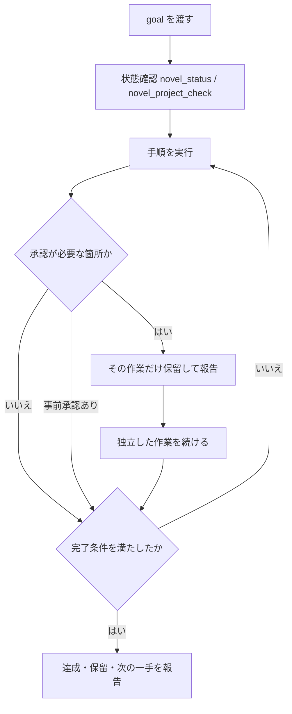

# goal モードで依頼する

このガイドを読むと、Claude・Codex・Cursor などの「goal（目標）を渡して自律的に進めさせる」使い方で、Monogatari Coach に制作を任せるときの依頼の書き方と、止まる箇所を把握できます。

「goal モード」は、ここでは**完了条件を書いた依頼を一度渡し、途中の細かい指示なしに複数の手順を続けて実行させる使い方**を指します。呼び出し方（スラッシュコマンド、専用入力欄、エージェントの自律実行設定など）はツールとバージョンによって異なります。入力方法は各ツールの最新の公式ドキュメントを確認してください。このページで説明するのは、どのツールでも共通の「何を書けば Monogatari Coach が安全に最後まで進められるか」です。

---

## 最小限の goal 文

次の 3 点が入っていれば動きます。

```text
novels/012_作品名 の第3章を、足切り判定まで通してください。
完了条件: 第3章が _novel_text に保存され、足切り判定の結果が保存されていること。
```

この文を goal として渡すと、Monogatari Coach は次のように動きます。

1. 最初の応答で `overview.mdを読み込みました！` と返し、ルールが読み込まれたことを示す
2. 作品の状態を確認し（`novel_status.py --next` と `novel_project_check.py`）、不足があれば先に報告する
3. 完了条件に向けて手順を実行し、**承認が必要な箇所**（後述）に当たったらそこで止まる
4. 最後に「達成した点・保留している点・次の一手」を報告する

長い指定は、より厳密に管理したいときの補足です。毎回書く必要はありません。

---

## 良い goal の 4 要素

| 要素 | 書くこと | 例 |
|------|----------|-----|
| 対象 | 作品フォルダと章・場面 | `novels/012_作品名` の第3章 |
| 完了条件 | ファイル・ツールの結果で確認できる状態 | `_novel_text/novel_text03.md` に保存され、`novel_char_count.py` で 4000±3% |
| 触ってよい範囲 | 変更してよいファイルと、守るもの | 第3章の本文と `_meta.md` のみ。他の章は変えない |
| 事前承認 | この依頼の中で先に認める項目（任意） | 子エピソードの追加案は承認する |

完了条件は「いい感じに仕上げる」ではなく、**ツールの結果やファイルの有無で確認できる形**にします。Monogatari Coach はファイルへ書き込み、再読込または対応する検証で確認してから完了と報告するためです。

---

## 実装例（コピペ用）

`NNN_作品名` と章番号は作品に合わせて置き換えてください。

### 新章の初稿を起草して保存する

```text
novels/NNN_作品名 の第3章の初稿を書いて保存してください。
完了条件: 場面の床字数に届き、publish まで完了し、_meta.md のストーリー反映が済んでいること。
他の章は変更しないでください。
```

METRON / CHRONOS が ON の作品では、Monogatari Coach は `prepare` → `receive` → `inspect` → `publish` の順で進めます。手順は [Writing bridge の局所修復と本文反映](../architecture/writing-bridge.md) を参照してください。

### 既存の章を目標字数に合わせる

```text
novels/NNN_作品名 の第5章を、清書後 4000 字に合わせてください。
完了条件: 許容帯に入り、保存前の確認が済み、publish されていること。
増量だけで届かない場合は、足す子エピソード案を出して止まってください。
```

引き締め・収束の候補は、消える文を確認してから採用する決まりです。そのため、この goal では保存前の確認で一度止まります（[止まる箇所](#止まる箇所)を参照）。

### 全章の下読みを一式まとめる

```text
novels/NNN_作品名 の全章を足切り判定（G1→G2→G3）して、結果を保存してください。
完了条件: 各章の判定が保存され、通過しなかった章の一覧が報告されていること。
本文は変更しないでください。
```

評価は読み取りだけなので、自律実行と相性が良い依頼です。保存先は [Reader Output](reader-output.md) を参照してください。

### 設定と本文の一貫性を監査する

```text
novels/NNN_作品名 の設定と本文の一貫性を監査してください。
完了条件: 設計（design）と本文（text）の監査が別々に保存され、矛盾の件数が報告されていること。
資料も本文も直さず、指摘だけ返してください。
```

### 評価の改善点を反映して質を上げる

```text
novels/NNN_作品名 の First Reader の改善点を反映して、作品の質を上げてください。
```

と入力すると、Monogatari Coach は次のように進めます。

1. 直近の評価ファイルの改善点を1件ずつ、「清書で反映する」「加筆案を出して承認を待つ」「事実の修正なので確認を待つ」「見送る（理由つき）」に振り分け、採否表を `_reader/_work/<日付>/triage.md` に保存する
2. 清書で反映できる分だけ本文を直して保存する
3. 加筆や事実の修正が要る項目は、挿入位置・内容・見込み字数を添えた案を出して止まる
4. 返答を受けて反映したあと、同じ段階（G3 など）で評価し直し、前回の点数との差を観点ごとに報告する

改善点の多くは、出来事や人物の心境を足すため加筆工程にあたります。加筆は承認が要るので、この goal は一度止まるのが普通です。止まらずに進めたいときは、次のように事前承認を書き添えてください。

```text
事前承認: 改善点を反映するための加筆は、1章あたり300字までなら承認したものとして進めてください。
```

評価し直すのは、保留がすべて解けてからです。保留が残っているうちに評価し直しても、清書だけの差しか測れないためです。改稿と評価を同じ Monogatari Coach が行ったときは、評価ファイルの冒頭にその旨が書かれます。自己評価になるため、点数の差は控えめに読んでください。

### 事前承認を含める

```text
novels/NNN_作品名 の第7章を 3600 字に合わせてください。
事前承認: 増量に必要な子エピソードの追加案は、私が承認したものとして進めてください。
```

事前承認は、**この依頼文に書いた項目だけ**が有効です。Monogatari Coach は `--authorization` などの記録欄に、依頼文の該当箇所を根拠として引用します。

### 避けたい書き方

| 書き方 | 問題 | 直し方 |
|--------|------|--------|
| 「第3章を良くしておいて」 | 完了条件が確認できない | 字数・判定・保存先で書く |
| 「全部やって、コミットして」 | 範囲が広く、git の許可も曖昧 | 対象を絞り、コミットする場合は明示する |
| 「画像を全部生成して」 | 課金が発生する | dry-run の確認までを goal にする |

---

## 止まる箇所

goal モードでも、次の箇所では Monogatari Coach が自動では進めません。

| 場面 | 止まる理由 | 再開のしかた |
|------|-----------|--------------|
| 新規作品の METRON / CHRONOS 設定 | 作成時に 1 回確認する。返答がなければ「未応答・既定 ON」として進む | 返答するか、そのまま進める |
| 子エピソードの追加・統合案 | 作品の設計を変えるため、案を出して承認を待つ | 承認する（事前承認でも可） |
| 引き締め・収束の候補採用 | 消える文に出来事・伏線が含まれないか確認が要る | 示された差分に返答する |
| 清書後の保存 | 主要な変化を保存前に 1 回見せる | 返答する |
| 出来事を削る改稿工程 | 参照チェックで問題がなく、ユーザーが承認したときだけ削る | 承認する |
| CHRONOS イベントの承認 | 承認は作者が行う | `approve` の内容を確認して返答する |
| 画像の本番生成 | 課金が発生する。dry-run のあとで承認を得る | dry-run を確認して承認する |
| git の add / commit / push、外部送信 | 明示された依頼がなければ行わない | goal 文に書いて許可する |
| `.env` などの秘密情報 | 読み込み・出力・記録をしない | 対象外のまま |

止まる箇所に当たっても、独立して進められる作業（ほかの章の評価など）は続けます。最後の報告に「保留中: 〇〇（承認待ち）」と一覧で残します。

承認を受けて作業したときは、報告に「承認の波及」の一覧も付きます。一つの承認で、本文のほかに設定（`character.md` / `world.md`）、設計書、`_meta.md` の章の状態、出版物（lock や proof PDF）が変わることがあるためです。goal 文で「変更しない」と書いた範囲に影響したものは、理由が添えられます。



---

## ツール別の使い方

どのツールでも goal 文の中身は同じです。違いは、ルールがどう読み込まれるかです。

| ツール | ルールの入口 | 確認のしかた |
|--------|--------------|--------------|
| Claude（Claude Code など） | `CLAUDE.md`（Rulesync の生成物） | 最初の応答に `overview.mdを読み込みました！` が出る |
| Codex CLI | `AGENTS.md`（Rulesync の生成物） | 同上。`AGENTS.md` は 32 KiB を超えると切り捨てられるため、生成物の更新後に [Rulesync の固定運用](../rulesync.md) の検査を行う |
| Cursor | `.cursor/` 配下の生成物 | 同上 |

- 入口ファイルは**生成物**です。内容を変えたいときは、直接編集せず `.rulesync/` の正本を直してから再生成します。
- 最初の応答に確認句が出ないときは、ルールが読み込まれていません。goal を始める前に `uv run python tools/rulesync.py generate --check` を実行して、生成物が最新か確認してください。
- 長時間の goal では、途中で会話が要約されることがあります。再開時に Monogatari Coach は `_meta.md` の「次回タスク」から作業を再構成します。**区切りの良い所で `_meta.md` を更新させる**一文を、goal 文に添えておくと確実です。

```text
区間の終わりごとに _meta.md の次回タスクを更新してください。
```

---

## ヘルプ

goal 文の書き方に迷ったときは、次のように入力します。

```text
goal モードで頼みたいです。今の状態に合う goal 文を作ってください。
```

と入力すると、Monogatari Coach は自動的に次を行います。

1. `novel_status.py --next` と `novel_project_check.py` で作品の現在地を確認する
2. 次にやるべき作業に合う goal 文を、対象・完了条件・触ってよい範囲つきで提示する
3. その作業で止まる箇所を先に伝える

作品を指定しないときは、`novels/` 内の作品から選んでよいかを尋ねます。

---

## 状況を確認する（goal_status）

goal がどこまで進んだかは、Monogatari Coach の申告ではなくツールの結果で確認できます。`goal_status.py` は、場面ごとの状態を判定し、章にまとめて表示します。

状態は 4 つに分かれます。

| 状態 | 意味 | 判定の根拠 |
|------|------|------------|
| できている | 場面の本文を保存済みで、いまの本文と一致する | `publish` 済みの run があり、いまの章ファイルのハッシュが、同じ章のいずれかの場面の保存時のハッシュと同じ（後の場面を同じ章ファイルへ保存しても、先の場面は「できている」のまま） |
| 作っている | 着手済みで、まだ保存に至っていない | run が進行中、修復中、保存後に本文が変わった、または後続の run が未保存 |
| 保留 | 修復が `escalated` で止まっている（報告と承認待ち） | run の `repair_state.json` の状態 |
| 未着手 | 場面の記録はあるが run がない | `_metron/` の場面があり `_writing/` の run がない |

本文があるのに場面の記録がない章は **「判定不能」** と表示し、「できている」には数えません。METRON / CHRONOS が OFF の作品や、従来経路で書いた章がこれに当たります。

章の状態は、場面から次のようにまとめます。保留が 1 つでもあれば「保留」、すべて「できている」なら「できている」、すべて「未着手」なら「未着手」、それ以外は「作っている」です。

読み取りだけを行うコマンドは次のとおりです。まず状況を表示します。

```bash
# 確認: 章ごとの状態と、_meta.md の「次回のタスク」との突合を表示する
uv run python tools/goal_status.py novels/NNN_作品名

# 達成判定: 第3章が保存済みで、4000字±3% に入っているかを確認する
uv run python tools/goal_status.py novels/NNN_作品名 --chapter 3 --chars 4000 --tolerance 0.97,1.03
```

達成判定は、満たした（OK）・未達（NG）・判定不能（??）で表示されます。未達が 1 つでもあると終了コードは 1、なければ 0 です。**判定不能は未達に数えません**が、「できている」とも報告しません。

`novel_status.py` のダッシュボードにも「goal の状況」欄が出ます。`--next` の出力は変わりません。

### `_meta.md` にまとめる

状況を `_meta.md` に残すと、会話が要約されたあとでも再開しやすくなります。次のコマンドで、`_meta.md` の「1.5 goal の状況」にある枠（`<!-- goal-status:begin -->` から `<!-- goal-status:end -->`）の中だけが書き換わります。

```bash
# 反映: 自動生成ブロックを更新する（枠の外の手書きは変わらない）
uv run python tools/goal_status.py novels/NNN_作品名 --write-meta
```

- 既定は表示だけで、`--write-meta` を付けたときだけ書き込みます。
- 枠がない作品では、「2. 執筆用コンテキスト」の直前に枠を足します。
- 手書きのメモは枠の外に書いてください。枠の中は実行のたびに作り直されます。
- 表には章ごとの状態、保存済み場面の数、保留の理由、突合の結果が入ります。

### 次回のタスクとの突合

`_meta.md` の「次回のタスク」と実際の状態のずれを、次の場合に知らせます。

- 次回タスクが、すでに「できている」章を指している
- 未完了の章があるのに、次回タスクに章の記載がない
- 次回タスクが指す章に未完了がなく、別の章が未完了のまま残っている
- 次回タスクが未記入

知らせるだけで、`_meta.md` の「次回のタスク」は自動では書き換えません。直すかどうかは Monogatari Coach が内容を確認して決めます。

---

## 現状の制約と今後の候補

| 領域 | 現状 | 案 |
|------|------|-----|
| 完了判定 | 保存と字数と検査の結果を `goal_status.py` で確認できる。完了条件が自由文のときは、機械で確認できる項目だけを判定する | 検査レイヤの計測状況や CANON 検査の結果も判定に含める |
| 保留の検出 | 機械が検出できるのは修復の `escalated` だけ。承認待ちの案（子エピソード追加など）は、報告に書かれた内容に頼る | 承認待ちを run に記録して拾えるようにする |
| 事前承認の記録 | `--authorization` に引用する運用で、記録先は run ごとに分かれる | goal 単位で承認内容をまとめて残す |
| 仕様の読み込み量 | `workflow-specification.md` が 1,700 行超と大きい | goal 用の短い索引を置く |

---

関連: [指示出しベースのワークフロー](instruction-driven.md)、[チャットモード](chat-writing-mode.md)、[ワークフロー索引](index.md)、[トラブルシューティング](troubleshooting.md)
