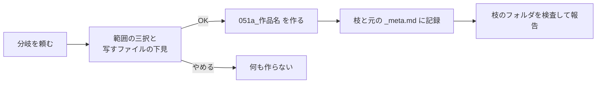

# 改訂版を分岐する（作品の改訂枝）

このガイドを読むと、発表や執筆から時間がたった作品、または設定が変わった作品を、元を残したまま改訂版として作り直せます。

改訂版は git のブランチではなく、作品フォルダの「兄弟」として作ります。元 `novels/051_作品名`（旧版）の隣に、改訂枝 `novels/051a_作品名` を作ります。番号 `051` はこのページの説明用の例です。

## このドキュメントを使う場面

### どんな場面で使うか

- 発表や執筆から時間がたち、同じ話をいまの方針で書き直したい
- 世界観・人物・章の出来事など設定が変わり、旧稿のままでは進めない
- 旧版は残し、改訂版だけ本文と設計を動かしたい
- 同じ設定で、別の書き方や別のモデルで一度書いて比べたい（比較用の分岐）

### チャットへの指示文

これだけ入力すれば動きます。

```text
novels/051_作品名 を改訂版として分岐してください。
```

と入力すると、Monogatari Coach は改訂の理由（時期や状況のどんな変化か）を一言確かめ、写す範囲の三択と、写すファイル・写さないファイル・概算サイズを見せて止まります。範囲を選んで「OK」と返すと、`novels/051a_作品名` を作ります。

比較だけしたいときは、次のように頼めます。

```text
novels/051_作品名 を比較用に分岐してください。
```

元と枝を比べるときは、次のように頼みます。

```text
051 と 051a を比較してください。
```

### Monogatari Coach が行うこと

1. 元フォルダを決め、次に使える枝の文字（`a` から順に未使用のもの）を選ぶ
2. 範囲を dry-run（下見）で見せて止まる。何も作らない
3. 承認後、選んだ範囲だけを写して `051a_作品名` を作る
4. 枝の `config.md` に、元の番号と改訂の理由を書く（METRON などの設定は元のまま引き継ぐ）
5. 枝と元の `_meta.md` に、分岐した日・理由・範囲を書く（元は書く前に旧版を退避する）
6. 枝のフォルダを検査し、結果を報告する。査証ログにも1行残す



### ユーザーが確認できるもの

- 新しいフォルダ `novels/051a_作品名/`
- 枝の `config.md` の基本情報表に増えた3行（`branch` / `parent_ID` / `branch_reason`）
- 枝と元の `_meta.md` の「1. 執筆フェーズ・ステータス」の中の「改訂枝」
- 元の旧版 `_novel_text_backup/_meta_vNNN.md`

## 写す範囲の三択

| 範囲 | 写すもの | 向いているとき |
|------|----------|----------------|
| 骨格 | 企画書・設計書・人物・世界観・`config.md`・`_meta.md` など作品直下のファイル | 設定だけ改訂し、本文は枝で書き直す |
| 骨格と本文（既定） | 骨格に加え `_novel_text/` | 既稿と設定を土台にストーリーを改訂する |
| 全体 | 上に加え原資料・参考資料・タグや漫画の YAML など | 画像の設計まで含めて同じ出発点にしたい |

どの範囲を選んでも、機械の記録（`_work/` など、METRON や執筆接続が残す計測の記録）は写しません。写すと、枝でまだ測っていない本文が測ったように見えてしまうためです。

評価（`_reader/` の中身）・旧版（`_novel_text_backup/`）・画像の実体・出版の lock・圧縮ファイルは、頼んだときだけ写します。評価を写さないのは、元の点数を枝の点数と混ぜないためです。

## 分岐したあと

- 以後は、指定したフォルダだけを相手にします。「051 を書いて」は元、「051a を書いて」は枝です。どちらか分からないとき、Monogatari Coach は一言確かめます。
- METRON が ON の作品から本文を写した枝では、写した章に計測の記録がありません。枝で新しい章を書く前に、写した章を後追いで計測します。
- 改訂枝の作成は新しい企画ではないので、企画の Gate B はやり直しません。設定の厚さからやり直したいときは、そう指示してください。
- 元への反映（枝の本文で元を上書きする）と、章ごとの取り込みは、いまの版にはありません。旧版と改訂版を並べて残すのが既定です。

## コマンドで操作する

チャットを使わずに操作するときのコマンドです。まず dry-run で範囲を確かめ、`--apply` を付けて作ります。

```bash
# 確認（dry-run）— 写すファイル・写さないファイル・概算サイズを表示する。何も作らない
uv run python tools/novel_branch.py fork --from novels/051_作品名 --reason revision

# 本番 — 範囲と理由を決めてから作る
#   --scope  : skeleton（骨格）/ skeleton_text（骨格と本文）/ full（全体）
#   --reason : revision（改訂）/ compare（比較）
#   --note   : 改訂の理由を口語で（_meta.md に残る）
uv run python tools/novel_branch.py fork --from novels/051_作品名 \
  --scope skeleton_text --reason revision \
  --note "発表から2年たち、設定を今の方針で直す" --apply
```

実行後、`novels/051a_作品名/` ができ、最後に `verify: OK` が表示されます。

元と枝の一覧と、層ごとの差分を見るコマンドです。

```bash
# 元と改訂枝の一覧（verify の結果つき）
uv run python tools/novel_branch.py list 051

# 差分 — 本文の章別文字数、設計書・人物表の項目数の増減を表示する
uv run python tools/novel_branch.py diff 051 051a --layer text,design,profile
```

評価や画像も写したいときは、`--include` を付けます（`reader` / `backup` / `images` / `chronos` / `publication` / `archives`。骨格の範囲では `source` / `references` も）。

## 名前の決まり

- 枝は番号の直後に英小文字1文字を付けます（`051a_作品名`、次は `051b_作品名`）。番号と文字のあいだに `_` は入れません。
- 枝は次の新作の番号を使いません。枝があっても、次の新作は `052_…` です。
- `config.md` の `novel_ID` は枝でも `051` のままです。

詳しい仕様は [ワークフロー詳細仕様の「改訂枝（作品分岐）」](../../.rulesync/rules/workflow-specification.md) にあります。
