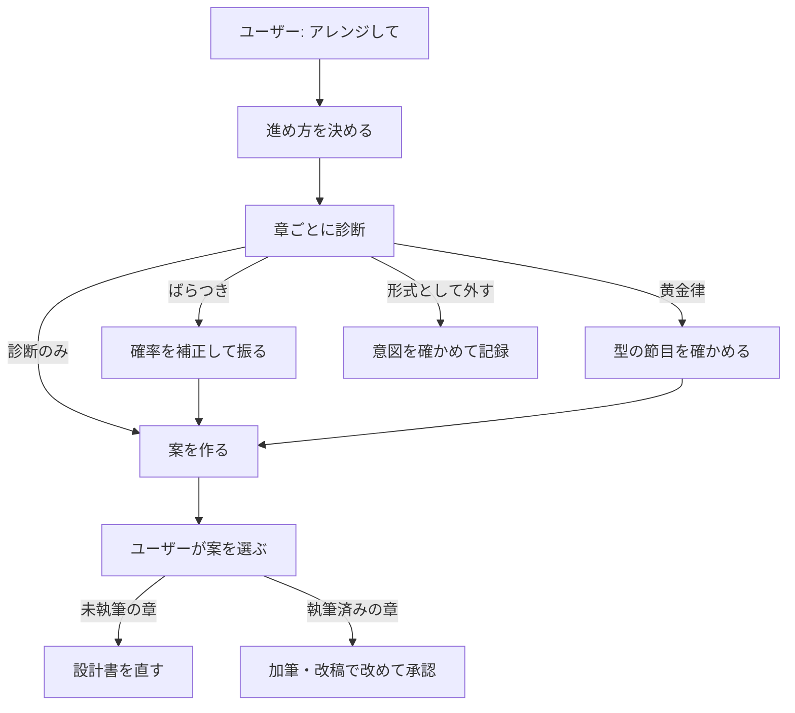

# プロットのアレンジ（転と山の当て方）

このガイドを読むと、「平板なので展開をアレンジしたい」ときに、Monogatari Coach がどう診断し、どう案を出すかと、型（三幕構成など）を使う・使わないの選び方が分かります。

## このガイドを使う場面

次のように頼むと、Monogatari Coach はスキル **novel-plot-arrange** で作業します。

```text
novels/123_作品名 のプロットが平板なので、アレンジしてください。
```

```text
後半の展開が読めてしまうので、第6章以降をもっと変えてほしい。
```

```text
この作品は三幕構成で組み直してください。
```

清書（文章の手直し）では使いません。転は出来事を足す・変えることなので、文章を整える作業の中では行いません。

## 4つの進め方（構造方針）

作品ごとに、型をどの強さで当てるかを選べます。指定しなければ「ばらつき」になります。

| 進め方 | 何をするか | 選び方 |
| --- | --- | --- |
| ばらつき（`rolled`） | 壊すと効くところで確率を上げ、いつ・何を壊すかを確率で振ります。壊し方の作法（残るもの、主人公の選択など）は固定です | 何も言わなければこれです |
| 黄金律（`golden`） | 三幕構成・ヒーローズ・ジャーニー・Save the Cat などの型の節目に、転と山を置きます | 「三幕構成で」など型を名指しします |
| 診断のみ（`diagnose`） | 振らずに、平坦な所や回収されていない約束を見つけて、案だけを出します | 「振らずに直して」と言います |
| 形式として外す（`none`） | 平坦・オチなしを形式として選びます。転は勧めません | 「平坦なままでいい」「オチの無い形式で」と言います |

すべての作品を型どおりに組むと、どの作品も同じ色になりがちです。そのため、型は意識して選んだときだけ使い、普段は確率でばらつかせる設計にしています。

## Monogatari Coach がすること

1. 構造論（流れ・山・オチ）と流れ破壊（転の作り方）の資料を読みます。作品の資料一覧に無くても読みます。
2. 章ごとに、持ち味の強さ・転の有無・先送りの溜まりを表にして、平坦な区間や回収されていない約束を探します。
3. ばらつきの場合は、確率を補正して振り、振るたびに記録を保存します。作品の長さから転の回数の目安（下限・上限）を決め、すでにある転も数えます。結末や後味など作品全体のことは、設計書や本文ですでに決まっていれば変えません（「結末も変えて」と頼んだときだけ振り直します）。
4. 「誰が何をして、何が変わるか」の形で2〜3案を出します。型の名前や確率は、案とは別の欄に書きます。
5. 採った案を反映します。まだ書いていない章は設計書を直します。書いた章は加筆・改稿として、改めて承認を求めます。設計書を直したときは、変えた項と前後の項に因果検査をかけ、人物がなぜ動いたかが読めるようにします（根拠の無い理由は作らず「要確認」で返します）。



決めるのはユーザーです。Monogatari Coach は、案を採るまで設計書や本文を書き換えません。

## 回数を変えたいとき

転の回数の目安は作品の長さで決まります（例: 6万字までは1〜2回）。次のように言えば、その作品だけ変えられます。

```text
この作品は転を入れなくていいです。
```

```text
もっと大きな転を増やしてください。
```

## 記録の場所

| 何を | どこに |
| --- | --- |
| 構造方針・採った案 | 作品の `_meta.md`（Gate B 記録の「構造方針」） |
| 抽選の記録（再現用。ばらつきのときだけ） | 作品の `_work/structure/draws.jsonl` |
| 確率の表 | `_how_to.example/episode/general/episode_structure_dosing.json` |

抽選は道具 `tools/novel_structure_draw.py` が行います。Monogatari Coach は、章ごとの診断の表を `_work/structure/diagnosis_<日時>.json` に保存してから道具に渡します。読み進み感想がある作品では、反応が平坦な章も判定に加えます。道具の使い方は [ツール一覧](../tools/index.md) にあります。

抽選の記録には、候補・重み・シード・使った表が残ります。同じ入力なら同じ結果を再現できます。記録は振った直後に保存されるので、案を採らなかったときや、選ぶ前に会話を終えたときも残ります。黄金律・診断のみ・形式として外す、の進め方では抽選しないので、この記録は作られません。

## 確率を調整したいとき

- **全作品の既定を変える**: 作業用の `_how_to/episode/general/episode_structure_dosing.json` を、標準の表をコピーして作り、数値を直します。作業用の表があれば、Monogatari Coach は標準の代わりにそちらを使います（二つを混ぜません）。
- **この作品だけ重みを変える**: 作品用の JSON（標準の表と同じ形）を作品フォルダに置き、`novels/<作品>/pick_registry/work.yaml` で `structure_*` の項目をその JSON へ向けます。
- **この作品だけ転の回数を変える**: チャットで「転は入れなくていい」「もっと増やして」と伝えます。`_meta.md` に記録されます。

`work.yaml` の書き方は [_how_to/ のガイド](../project-structure/how-to-area.md) と抽選レジストリの説明（`_how_to.example/pick_registry/README.md`）を参照してください。

## 関連

- 創作技法: [流れ・山・オチの構造論](../../_how_to.example/episode/general/episode_flow_peak_payoff.md)、[流れ破壊と転の設計](../../_how_to.example/episode/general/episode_flow_break.md)、[黄金律の構造](../../_how_to.example/episode/general/episode_golden_structure.md)
- 企画: [Planning](planning.md)
- スキルの詳細（Monogatari Coach の手順）: [novel-plot-arrange](../../.rulesync/skills/novel-plot-arrange/SKILL.md)
