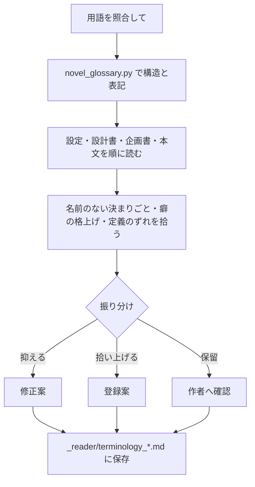

# 作品固有の用語と用語照合

このガイドを読むと、作品固有の名前（造語）を `world.md` の用語集で管理する方法と、本文に紛れ込んだ造語や設定の書き足しを照合する方法が分かります。

生成モデルによっては、本文を書く途中で新しい単語や、名前のない仕組み・決まりごとを書き足すことがあります（Grok で起きやすいことが分かっています）。Monogatari Coach は、こうした発明を一律に消すのではなく、作品に効くものは用語として拾い上げ、根拠のないものは抑えるように扱います。

---

## このドキュメントを使う場面

| 場面 | 使うもの |
|------|----------|
| 新しい作品の世界設定を作る | `world.md` の `## 用語` の表 |
| 本文を書かせたら、知らない単語や決まりごとが出てきた | 用語照合 |
| 書いたモデルとは別のモデルに、造語を点検させたい | 用語照合（別セッションで依頼する） |
| 用語集の形だけを機械で確かめたい | `novel_glossary.py` |

### チャットへの指示文

これだけ入力すれば動きます。

```text
novels/NNN_作品名 の用語を照合してください。
```

と入力すると、Monogatari Coach は次のように進めます。

1. `tools/novel_glossary.py` で、用語集の形と、避ける表記の出現を機械で確かめる
2. `world.md` → `character.md` → 設計書 → 企画書 → 本文の順に読む（設計の段階で生まれたずれを先に見つけるため）
3. 機械では拾えないもの（名前のない決まりごと、人物の癖を村や店の決まりとして言い切った箇所、用語の定義と違う使い方、説明なしに初めて出てくる独自の語）を文脈から拾う
4. 指摘ごとに「抑える／拾い上げる／保留」に振り分け、拾い上げる語には用語集にそのまま貼れる登録案を付ける
5. 結果を `_reader/terminology_YYYYMMDD_HHMM.md` に保存し、`_meta.md` の評価履歴に 1 行足す

本文も `world.md` も書き換えません。登録案を採用するか、どの指摘を直すかは、報告を見て指示してください。

より詳細に指定したい場合:

```text
novels/NNN_作品名 の第1〜2章の用語を照合してください。
本文と設定は変更しないでください。拾い上げた語の登録案は、承認待ちの表に貼れる形で出してください。
```

### ユーザーが確認できるもの

- `novels/<作品>/_reader/terminology_YYYYMMDD_HHMM.md` — 指摘の表（ファイルと行、原文、理由、振り分け、修正案・登録案）と、残してよい正常例
- 作品 `_meta.md` の評価履歴の 1 行（振り分けごとの件数）
- チャットには、振り分けごとの件数・保存先・拾い上げの登録案・保留の一覧だけが返ります

---

## 用語集の書き方

作品固有の名前は、`world.md` に `## 用語` の表で書きます。本文を書く途中で新しい名前が必要になったときに使う `## 用語（承認待ち）` の表も、同じ列で置きます。

```markdown
## 用語

| 用語ID | 正式名称 | 種別 | 定義・適用範囲 | 許容表記・略称 | 避ける表記 | 備考 |
|--------|----------|------|----------------|----------------|------------|------|
| term_001 | 火継ぎ | 技術 | 親方の炉の火を、弟子の炉へ移す作業。炭火に限る | ― | 火魔法、点火術 | |

## 用語（承認待ち）

| 用語ID | 正式名称 | 種別 | 定義・適用範囲 | 許容表記・略称 | 避ける表記 | 備考 |
|--------|----------|------|----------------|----------------|------------|------|
```

- **種別**は、場所・組織・制度・技術・現象・物・行為・役職・その他から選びます。「行為」として定義した語を本文で「物」として使っている、といったずれを見つける手がかりになります。
- **避ける表記**には、同じ物事を指すが使ってほしくない言い方（「魔力」「マナ」のような汎用の言い換え）を書きます。
- 書式の正本と判定の基準は [`_how_to.example/world_glossary.md`](../../_how_to.example/world_glossary.md) です。

既存の作品で `## 用語集` や箇条書きで書いた用語は、そのまま読めます（名前と定義だけを読み、許容表記・避ける表記の照合はしません）。新しい書式へ移したいときだけ、「用語集を新しい書式にしてください」と指示してください。

### 既存の作品

既存の作品は、一斉には新しい書式へ移しません。作品に手を入れるときに、Monogatari Coach は次のように扱います。

| 作品の状態 | Monogatari Coach の扱い |
|------------|-------------------------|
| 用語集が無い | 続きを書く途中で新しい名前が要った時点で、`## 用語（承認待ち）` の表を作ります。今ある独自の語をまとめて登録するのは、用語照合を頼んだときだけです |
| 旧形式 | そのまま読みます。新しい語を足すときに「新しい書式へ移しますか」と一度だけ聞きます。断った場合は、新しい語だけを承認待ちの表に書きます |
| 新しい書式で種別の列が無い | 用語集を直すときに種別の列を足します |

造語の多い作品（ファンタジー・SF・独自の職業もの）を、造語を作りやすいモデル（Grok など）で書いた場合は、続きを書く前や清書の前に「先に用語照合をしますか」と一言勧めます。照合の報告がすでにあり、その後に設定が変わっていなければ勧めません。照合を始めるのは、頼んだときだけです。

用語集が無い作品でも、清書や「わかりやすくして」では、初出の説明と一字の語の読み直しを行います。

### 本文を書くときの決まり

Monogatari Coach は、本文を書く途中で新しい名前や決まりごと（「〜できる」「〜してはならない」）が必要になったら、本文に出す前に `## 用語（承認待ち）` へ登録案を書き、完了報告で知らせます。正式な `## 用語` へ移すのは、ユーザーが承認したあとです。

独自の語は使ってかまいませんが、説明なしに語りだすことはしません。用語集に登録しても読者には見えないため、Monogatari Coach は次のように書きます。

- 本文・あらすじ・ログラインで独自の語を初めて出すときは、その文か同じ場面のすぐ近くで、意味が取れるようにする（例: 「親方の炉の火を弟子の炉へ移す火継ぎ」）。説明は用語集の定義の範囲にとどめ、新しい事実は足しません。
- 用語集の定義文をそのまま地の文に写しません。視点人物がその場で見たり聞いたり推し量ったりできる形で示します（衛兵が服を指して「蛮族」と叫ぶ、連れが「たぶん身分証のことだ」と言う）。視点人物がまだ知りえない意味は、地の文で言い切らず、聞き取った音や謎として出します。謎として伏せる語は、伏せていることがその場で分かれば、意味を明かすのは後の章でかまいません。
- 説明を次の章まで後回しにしない。
- ログラインに入れる独自の語は一つまで。ほかは普通の言葉で書く。
- 一字の漢語（口・白・端・打 など）や、動詞から作った名詞（届き など）を、作中の特定の物事を指す名詞に縮めて使わない。たとえば「打が弱い」「白が残る」「端は、次だ」「速さは、届きではない」は、「鐘を打つ力が弱い」「白い霧の帯が残る」「港口の端は、次の夜明けだ」「速く打っても、遠くへ届くわけではない」と普通の語で書く。「手」「音」のように一般の意味のまま使う一字の語は問題ありません。判定は語だけでなく、述語と合わせて読みます（「端は、次だ」の端は、へりではなく、へりの霧を払う仕事を指しています）。置き換えるときは、元の意味をそのまま開きます。「打が弱い」を「二打の間隔が短い」のように別の原因の語に替えると、設定の因果が変わってしまいます（正しくは「打つ力が弱い」）。元の意味が一つに定まらないときは、Monogatari Coach は置き換えずに候補を挙げて確かめます。

用語集の定義に手順や条件がある語（技術・制度・現象）は、本文でもその手順・条件どおりに描きます。たとえば定義が「空に見える線を指で追う」なら、本文で「星の位置を測って砂へ移す」と別の手順にはしません。定義に「〜するまで確定しない」とあれば、台詞で「確定する前でも札を出せます」とは言わせません。描き方を変えたいときは、Monogatari Coach は本文より先に、用語集の定義を直す案を出します。用語照合と設定監査では、この食い違いを「定義の手順・条件と描き方のずれ」として確かめます。

清書を頼んだときや、「わかりやすくして」「読みやすくして」と頼んだときも、Monogatari Coach は清書の最後にこの 2 点（初出の説明と一字の語）で本文を読み直し、直した箇所を完了報告に書きます。

用語照合では、これを「初出の説明不足」「一字の語の略用」として、用語集への登録の有無とは別に確かめます。初出の説明不足は語を消さずに言い換えを添え、一字の語の略用は普通の語に置き換えます。一字の語の略用は機械では見分けられない（一字の名詞の大半は普通の語のため）ので、文脈を読んで判定します。

承認待ちの語を正式な表へ移すかは、次の観点で決めます。

| 観点 | 移さない例 |
|------|------------|
| 普通の日本語で書けるか | 「炉の前の石床」で足りる場所に名前を付けた |
| 一般語とぶつからないか | 既にある一般語と同じ字面で、別の意味を持たせた |
| 定義と使い方が合うか | 行為として定義したのに、本文では物として使っている |
| 既存の設定と矛盾しないか | 「炭火に限る」作業を、油の灯で行っている |
| 繰り返し使うか | 一度しか出ない説明のための名前 |

---

## モデルによる違い

| 傾向 | 例 | Monogatari Coach の扱い |
|------|----|-------------------------|
| 独特な造語を多く作る | Grok。造語を用語集に先に登録するが、ログラインや本文の初出で説明なしに並べやすい | 承認待ちへの登録と初出の説明を省かせない。書き終えたら、別のモデル・別のセッションで用語照合を頼むと見落としが減ります |
| 発明を自然な語で書く | ChatGPT。一般語を組み合わせた語（「返り音」など）で、読者には分かりやすいが、造語として用語集に載せ忘れやすい | 仕組みや決まりを書いたら用語集に載せる |
| 発明が少ない | 一般語や型どおりの語に流れやすいモデル | 企画のときに作品固有の用語を数語作り、設計書でそれを使う場面を用意する |

書いたモデル自身に照合させると、自分の書き足しを見落としやすくなります。報告の冒頭には、書いた役と照合した役が記録され、同じ場合は「自己検査」と書かれます。

Grok に自作を照合させた試行では、はっきりした略用（「打」「名」）は拾えましたが、一般の意味を持つ字を縮めた形（「端は、次だ」）と、動詞から作った名詞（「届き」）は見落としました。Grok で書いた作品は、別のモデルでも照合してください。

---

## 機械の照合だけを行う

用語集の形と、避ける表記の出現だけを確かめます。ファイルは書き換えません。

```powershell
# 用語集の構造と、設定・企画・本文の表記を照合する
uv run python tools/novel_glossary.py novels/NNN_作品名

# 本文のカタカナの未登録候補も出す（確度は低い）
uv run python tools/novel_glossary.py novels/NNN_作品名 --katakana
```

出力の「承認待ちの語の使用」には、宣言された新語がどのファイルで何回使われたかが出ます。機械の照合が 0 件でも、造語や設定の書き足しが無いとは限りません。名前のない決まりごとは文脈を読まないと拾えないため、チャットで用語照合を依頼してください。



一貫性監査（Consistency Audit）とは役割が違います。一貫性監査は資料と本文の事実の食い違いを、用語照合は用語集を軸にした名前と決まりごとを見ます。同じ箇所が両方で指摘されることがあります。一貫性監査は [Reader Output](reader-output.md) を参照してください。
